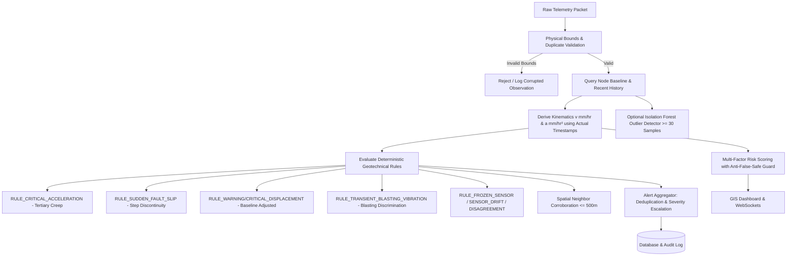

# MineGuard-AI Risk Model & Geotechnical Decision Engine

## 1. Safety Notice, Regulatory Notice & Geotechnical Disclaimer

> [!WARNING]
> **Regulatory Notice (DGMS Compliance Baseline)**:
> MineGuard-AI is an open geotechnical monitoring and early-warning research prototype developed for Smart India Hackathon problem SIH26025. 
> Numerical parameters, warning levels, and simulation scenarios represent baseline demonstration thresholds.
> In active open-cast or underground mining operations, actual hazard classification mandates compliance with the Directorate General of Mines Safety (DGMS) circulars, on-site rock mass rating (RMR) calibration, and formal sign-off by a qualified geotechnical engineer.
> **Algorithmic rule outputs and unsupervised machine learning anomaly scores indicate statistical or physical deviation; they are strictly NOT empirical probabilities of slope failure or ground collapse.**

---

## 2. Interpretable Geotechnical Analytics Architecture

Ground deformation monitoring in open-cast benches and subsidence-prone overburden requires decoupled evaluation of **physical kinematics** and **sensor measurement fidelity**. Silence, missing channels, or corrupted packets must never produce a false "safe" green status.

---

## 3. Kinematic Derivation Using Actual Measurement Timestamps

Subsidence sensors in harsh mining environments transmit over LoRaWAN or RS485 with packet jitter, variable sampling periods, and temporary gateway outages.

### 3.1 Velocity ($v$) in $\text{mm/hr}$
Given current measurement $(t_{\text{curr}}, d_{\text{curr}})$ and previous valid record $(t_{\text{prev}}, d_{\text{prev}})$:

$$\Delta t_{\text{hours}} = \frac{t_{\text{curr}} - t_{\text{prev}}}{3600.0}$$

$$v = \frac{d_{\text{curr}} - d_{\text{prev}}}{\Delta t_{\text{hours}}}$$

- **Sub-Second Guard**: If $\Delta t < 0.5\text{ seconds}$, kinematics derivation is skipped to prevent division by near-zero numerical noise from duplicated packet retries.
- **Irregular Interval Tagging**: When $\Delta t > 300\text{ seconds}$, the calculation is flagged as time-averaged rate with explicit uncertainty attribution.

### 3.2 Acceleration ($a$) in $\text{mm/hr}^2$
When the previous observation also contains a valid velocity $v_{\text{prev}}$:

$$a = \frac{v - v_{\text{prev}}}{\Delta t_{\text{hours}}}$$

Positive acceleration ($a \ge 0.5\text{ mm/hr}^2$) combined with sustained movement ($v > 0.1\text{ mm/hr}$) triggers tertiary creep alerting.

---

## 4. Per-Node Baselines & Datum Compensation

Raw displacement readings from borehole wireline extensometers reflect initial installation pretension. MineGuard-AI maintains per-node calibration baselines (`NodeBaseline`):

1. **Sample Sufficiency**: Requires $\ge 5$ observations over the baseline calibration window.
2. **Parameters Stored**: $\mu_{\text{disp}}, \sigma_{\text{disp}}, \mu_{\theta_x}, \sigma_{\theta_x}, \mu_{\theta_y}, \sigma_{\theta_y}, \mu_{\text{temp}}$.
3. **Datum Subtraction**: Evaluated displacement is adjusted against baseline mean:
   $$d_{\text{eval}} = d_{\text{raw}} - \mu_{\text{disp}}$$
4. **Persistent Baseline Departure**: Resultant tilt departure from baseline orientation is tracked:
   $$\theta_{\text{offset}} = \sqrt{(\theta_{x,\text{curr}} - \mu_{\theta_x})^2 + (\theta_{y,\text{curr}} - \mu_{\theta_y})^2}$$
   When $\theta_{\text{offset}} \ge 2.0^\circ$, `RULE_PERSISTENT_TILT_SHIFT` is triggered.
5. **Audit Trail**: Every baseline recalculation produces an `AuditEvent` with action `RECALCULATE_BASELINE` and outcome `SUCCESS` or `INSUFFICIENT_SAMPLES`.

---

## 5. Geotechnical Decision Rules

| Rule Identifier | Trigger Condition | Severity | Category | Uncertainty Classification | Description |
|---|---|---|---|---|---|
| `RULE_CRITICAL_ACCELERATION` | $a \ge 0.5\text{ mm/hr}^2 \land v > 0.1\text{ mm/hr}$ | `CRITICAL` | `ACCELERATION` | `HIGH_CONFIDENCE_PHYSICAL` | Tertiary creep phase preceding slope rupture |
| `RULE_SUDDEN_FAULT_SLIP` | $\|\Delta d\| \ge 8.0\text{ mm} \land \Delta t \le 300\text{s}$ | `CRITICAL` | `DISPLACEMENT` | `HIGH_CONFIDENCE_PHYSICAL` | Abrupt shear displacement along rock mass discontinuity |
| `RULE_CRITICAL_DISPLACEMENT` | $\|d_{\text{eval}}\| \ge 30.0\text{ mm}$ | `CRITICAL` | `DISPLACEMENT` | `HIGH_CONFIDENCE_PHYSICAL` | Critical cumulative ground settlement |
| `RULE_WARNING_DISPLACEMENT` | $\|d_{\text{eval}}\| \ge 15.0\text{ mm}$ | `WARNING` | `DISPLACEMENT` | `MODERATE_SINGLE_NODE` | Warning cumulative ground settlement |
| `RULE_CRITICAL_VELOCITY` | $\|v\| \ge 5.0\text{ mm/hr}$ | `CRITICAL` | `VELOCITY` | `HIGH_CONFIDENCE_PHYSICAL` | Dangerous deformation rate |
| `RULE_WARNING_VELOCITY` | $\|v\| \ge 2.0\text{ mm/hr}$ | `WARNING` | `VELOCITY` | `MODERATE_SINGLE_NODE` | Elevated deformation rate |
| `RULE_CRITICAL_TILT` | $\theta \ge 5.0^\circ$ | `CRITICAL` | `TILT` | `HIGH_CONFIDENCE_PHYSICAL` | Critical rotational ground tilt |
| `RULE_WARNING_TILT` | $\theta \ge 2.0^\circ$ | `WARNING` | `TILT` | `MODERATE_SINGLE_NODE` | Elevated rotational ground tilt |
| `RULE_PERSISTENT_TILT_SHIFT` | $\theta_{\text{offset}} \ge 2.0^\circ$ relative to baseline | `WARNING` | `TILT` | `MODERATE_SINGLE_NODE` | Persistent inclinometer baseline shift |
| `RULE_TRANSIENT_BLASTING_VIBRATION` | $\text{RMS} \ge 3.0\text{ m/s}^2 \land \|\Delta d\| \le 0.15\text{ mm}$ | `WATCH` | `VIBRATION` | `HIGH_CONFIDENCE_BLAST_DISCRIMINATION` | Transient production blast without permanent ground settlement |
| `RULE_CRITICAL_VIBRATION` | $\text{RMS} \ge 10.0\text{ m/s}^2$ | `CRITICAL` | `VIBRATION` | `HIGH_CONFIDENCE_PHYSICAL` | Severe dynamic seismic hazard |
| `RULE_SENSOR_DISAGREEMENT_TILT` | $\Delta \theta \ge 2.5^\circ \land \|\Delta d\| \le 0.08\text{ mm}$ | `WARNING` | `SENSOR_DISAGREEMENT` | `INSTRUMENT_DISAGREEMENT` | Inclinometer rotation with zero extensometer movement (bracket slip) |
| `RULE_FROZEN_SENSOR` | 6 identical successive readings | `DATA_UNRELIABLE` | `SENSOR_DRIFT` | `FROZEN_SENSOR_ERROR` | Stuck ADC, frozen transducer, or signal line disconnection |
| `RULE_SENSOR_DRIFT` | Monotonic $\Delta \theta \ge 0.8^\circ$ over $\ge 6$ frames with $d = 0$ | `WATCH` | `SENSOR_DRIFT` | `HIGH_UNCERTAINTY_DRIFT` | Monotonic electronic drift without physical movement |
| `RULE_MACRO_SUBSIDENCE_CORROBORATED` | Moving node spatially corroborated by neighbor within $\le 500\text{m}$ | `CRITICAL` | `DISPLACEMENT` | `HIGH_CONFIDENCE_CORROBORATED` | Multi-node confirmed open-cast bench deformation |

---

## 6. Spatial Corroboration Mechanism

Single-point sensor alerts in open-pit environments frequently arise from wildlife collision, rockfall against a casing, or thermal mounting creep. To avoid false mine evacuations:
- When a target node reports elevated movement ($d \ge 15.0\text{ mm}$ or $v \ge 2.0\text{ mm/hr}$), the engine queries all active enabled nodes within $R \le 500\text{ m}$ using the **Haversine formula**:
  $$a = \sin^2\left(\frac{\Delta \phi}{2}\right) + \cos(\phi_1)\cos(\phi_2)\sin^2\left(\frac{\Delta \lambda}{2}\right)$$
  $$c = 2 \operatorname{atan2}\left(\sqrt{a}, \sqrt{1 - a}\right), \quad d_{\text{m}} = 6371000 \cdot c$$
- If $\ge 1$ neighbouring node within $500\text{m}$ also reports elevated movement, the pattern is confirmed as contiguous bench instability (`RULE_MACRO_SUBSIDENCE_CORROBORATED`), and uncertainty is elevated to `HIGH_CONFIDENCE_CORROBORATED`.
- If neighbouring nodes remain stable, the movement is flagged with uncertainty `UNCONFIRMED_SINGLE_POINT`.

---

## 7. Anti-False-Safe Architecture

In geotechnical life-safety monitoring, **absence of evidence is NOT evidence of safety**. 
The risk scoring engine (`calculate_risk_profile`) enforces strict safeguards:
1. **Missing Physical Channels**: If both displacement and vector tilt are `None` (e.g. sensor dropout), `data_quality_score` is capped at $20.0$, and the category is strictly forced to `DATA_UNRELIABLE`. It can NEVER report `NORMAL` or `SAFE`.
2. **Stale Telemetry**: If a node has not transmitted within `STALE_DATA_TIMEOUT_SEC` (default 300s), category is forced to `DATA_UNRELIABLE`.
3. **Offline Status**: Nodes with connectivity `OFFLINE` report `data_quality_score = 0.0` and category `DATA_UNRELIABLE`.

---

## 8. Multivariate Anomaly Detection (Isolation Forest)

MineGuard-AI integrates a separate, explicitly labelled unsupervised model (`MultivariateAnomalyDetector`):

- **Model Label**: `ML_ISOLATION_FOREST_OUTLIER`.
- **Training Data Guard**: Strictly requires $\ge 30$ valid baseline observation frames (`ML_MIN_SAMPLES_TRAIN`). If fewer than 30 samples exist, the model remains untrained and prediction returns `status: "UNTRAINED_INSUFFICIENT_DATA"`.
- **Feature Vector**: $[d, \theta_x, \theta_y, v, \text{vibration\_rms}, \text{temperature}]$.
- **Decision Function Metric**: Outputs an unsupervised outlier decision distance in $[-1.0, 1.0]$ where values $< 0.0$ represent statistical anomalies relative to the training manifold.
- **Attribution**: Automatically identifies the primary contributing channel with the largest normalized deviation.
- **Strict Disclaimer**: Model outputs are accompanied by metadata confirming:
  `"is_probability_of_collapse": false`
  `"disclaimer": "Isolation Forest anomaly score represents an unsupervised multivariate outlier decision distance (-1.0 to 1.0). This score is NOT an empirical probability of slope failure or collapse."`

---

## 9. Alert Lifecycle & Audit Trail

- **Deduplication**: Active alerts for the same node and category are deduplicated to prevent alert storms.
- **Severity Escalation**: If an existing active alert (e.g. `WARNING`) experiences worsening physical conditions (e.g. `CRITICAL`), the alert is escalated in-place and an `AuditEvent` with action `ESCALATE_ALERT` is recorded with `old_severity` and `new_severity`.
- **Human Acknowledgement**: Shift supervisors acknowledge active alerts via `POST /api/v1/alerts/{id}/acknowledge`, capturing the engineer identity and logging an `ACKNOWLEDGE_ALERT` audit record.
- **Resolution**: Resolved alerts require mandatory resolution notes explaining the field inspection outcome, persisted with action `RESOLVE_ALERT`.

### 3.1 Velocity ($v$) in $\text{mm/hr}$
Given current measurement $(t_{\text{curr}}, d_{\text{curr}})$ and previous valid record $(t_{\text{prev}}, d_{\text{prev}})$:

$$\Delta t_{\text{hours}} = \frac{t_{\text{curr}} - t_{\text{prev}}}{3600.0}$$

$$v = \frac{d_{\text{curr}} - d_{\text{prev}}}{\Delta t_{\text{hours}}}$$

- **Sub-Second Guard**: If $\Delta t < 0.5\text{ seconds}$, kinematics derivation is skipped to prevent division by near-zero numerical noise from duplicated packet retries.
- **Irregular Interval Tagging**: When $\Delta t > 300\text{ seconds}$, the calculation is flagged as time-averaged rate with explicit uncertainty attribution.

### 3.2 Acceleration ($a$) in $\text{mm/hr}^2$
When the previous observation also contains a valid velocity $v_{\text{prev}}$:

$$a = \frac{v - v_{\text{prev}}}{\Delta t_{\text{hours}}}$$

Positive acceleration ($a \ge 0.5\text{ mm/hr}^2$) combined with sustained movement ($v > 0.1\text{ mm/hr}$) triggers tertiary creep alerting.

---

## 4. Per-Node Baselines & Datum Compensation

Raw displacement readings from borehole wireline extensometers reflect initial installation pretension. MineGuard-AI maintains per-node calibration baselines (`NodeBaseline`):

1. **Sample Sufficiency**: Requires $\ge 5$ observations over the baseline calibration window.
2. **Parameters Stored**: $\mu_{\text{disp}}, \sigma_{\text{disp}}, \mu_{\theta_x}, \sigma_{\theta_x}, \mu_{\theta_y}, \sigma_{\theta_y}, \mu_{\text{temp}}$.
3. **Datum Subtraction**: Evaluated displacement is adjusted against baseline mean:
   $$d_{\text{eval}} = d_{\text{raw}} - \mu_{\text{disp}}$$
4. **Persistent Baseline Departure**: Resultant tilt departure from baseline orientation is tracked:
   $$\theta_{\text{offset}} = \sqrt{(\theta_{x,\text{curr}} - \mu_{\theta_x})^2 + (\theta_{y,\text{curr}} - \mu_{\theta_y})^2}$$
   When $\theta_{\text{offset}} \ge 2.0^\circ$, `RULE_PERSISTENT_TILT_SHIFT` is triggered.
5. **Audit Trail**: Every baseline recalculation produces an `AuditEvent` with action `RECALCULATE_BASELINE` and outcome `SUCCESS` or `INSUFFICIENT_SAMPLES`.

---

## 5. Geotechnical Decision Rules

| Rule Identifier | Trigger Condition | Severity | Category | Uncertainty Classification | Description |
|---|---|---|---|---|---|
| `RULE_CRITICAL_ACCELERATION` | $a \ge 0.5\text{ mm/hr}^2 \land v > 0.1\text{ mm/hr}$ | `CRITICAL` | `ACCELERATION` | `HIGH_CONFIDENCE_PHYSICAL` | Tertiary creep phase preceding slope rupture |
| `RULE_SUDDEN_FAULT_SLIP` | $\|\Delta d\| \ge 8.0\text{ mm} \land \Delta t \le 300\text{s}$ | `CRITICAL` | `DISPLACEMENT` | `HIGH_CONFIDENCE_PHYSICAL` | Abrupt shear displacement along rock mass discontinuity |
| `RULE_CRITICAL_DISPLACEMENT` | $\|d_{\text{eval}}\| \ge 30.0\text{ mm}$ | `CRITICAL` | `DISPLACEMENT` | `HIGH_CONFIDENCE_PHYSICAL` | Critical cumulative ground settlement |
| `RULE_WARNING_DISPLACEMENT` | $\|d_{\text{eval}}\| \ge 15.0\text{ mm}$ | `WARNING` | `DISPLACEMENT` | `MODERATE_SINGLE_NODE` | Warning cumulative ground settlement |
| `RULE_CRITICAL_VELOCITY` | $\|v\| \ge 5.0\text{ mm/hr}$ | `CRITICAL` | `VELOCITY` | `HIGH_CONFIDENCE_PHYSICAL` | Dangerous deformation rate |
| `RULE_WARNING_VELOCITY` | $\|v\| \ge 2.0\text{ mm/hr}$ | `WARNING` | `VELOCITY` | `MODERATE_SINGLE_NODE` | Elevated deformation rate |
| `RULE_CRITICAL_TILT` | $\theta \ge 5.0^\circ$ | `CRITICAL` | `TILT` | `HIGH_CONFIDENCE_PHYSICAL` | Critical rotational ground tilt |
| `RULE_WARNING_TILT` | $\theta \ge 2.0^\circ$ | `WARNING` | `TILT` | `MODERATE_SINGLE_NODE` | Elevated rotational ground tilt |
| `RULE_PERSISTENT_TILT_SHIFT` | $\theta_{\text{offset}} \ge 2.0^\circ$ relative to baseline | `WARNING` | `TILT` | `MODERATE_SINGLE_NODE` | Persistent inclinometer baseline shift |
| `RULE_TRANSIENT_BLASTING_VIBRATION` | $\text{RMS} \ge 3.0\text{ m/s}^2 \land \|\Delta d\| \le 0.15\text{ mm}$ | `WATCH` | `VIBRATION` | `HIGH_CONFIDENCE_BLAST_DISCRIMINATION` | Transient production blast without permanent ground settlement |
| `RULE_CRITICAL_VIBRATION` | $\text{RMS} \ge 10.0\text{ m/s}^2$ | `CRITICAL` | `VIBRATION` | `HIGH_CONFIDENCE_PHYSICAL` | Severe dynamic seismic hazard |
| `RULE_SENSOR_DISAGREEMENT_TILT` | $\Delta \theta \ge 2.5^\circ \land \|\Delta d\| \le 0.08\text{ mm}$ | `WARNING` | `SENSOR_DISAGREEMENT` | `INSTRUMENT_DISAGREEMENT` | Inclinometer rotation with zero extensometer movement (bracket slip) |
| `RULE_FROZEN_SENSOR` | 6 identical successive readings | `DATA_UNRELIABLE` | `SENSOR_DRIFT` | `FROZEN_SENSOR_ERROR` | Stuck ADC, frozen transducer, or signal line disconnection |
| `RULE_SENSOR_DRIFT` | Monotonic $\Delta \theta \ge 0.8^\circ$ over $\ge 6$ frames with $d = 0$ | `WATCH` | `SENSOR_DRIFT` | `HIGH_UNCERTAINTY_DRIFT` | Monotonic electronic drift without physical movement |
| `RULE_MACRO_SUBSIDENCE_CORROBORATED` | Moving node spatially corroborated by neighbor within $\le 500\text{m}$ | `CRITICAL` | `DISPLACEMENT` | `HIGH_CONFIDENCE_CORROBORATED` | Multi-node confirmed open-cast bench deformation |

---

## 6. Spatial Corroboration Mechanism

Single-point sensor alerts in open-pit environments frequently arise from wildlife collision, rockfall against a casing, or thermal mounting creep. To avoid false mine evacuations:
- When a target node reports elevated movement ($d \ge 15.0\text{ mm}$ or $v \ge 2.0\text{ mm/hr}$), the engine queries all active enabled nodes within $R \le 500\text{ m}$ using the **Haversine formula**:
  $$a = \sin^2\left(\frac{\Delta \phi}{2}\right) + \cos(\phi_1)\cos(\phi_2)\sin^2\left(\frac{\Delta \lambda}{2}\right)$$
  $$c = 2 \operatorname{atan2}\left(\sqrt{a}, \sqrt{1 - a}\right), \quad d_{\text{m}} = 6371000 \cdot c$$
- If $\ge 1$ neighbouring node within $500\text{m}$ also reports elevated movement, the pattern is confirmed as contiguous bench instability (`RULE_MACRO_SUBSIDENCE_CORROBORATED`), and uncertainty is elevated to `HIGH_CONFIDENCE_CORROBORATED`.
- If neighbouring nodes remain stable, the movement is flagged with uncertainty `UNCONFIRMED_SINGLE_POINT`.

---

## 7. Anti-False-Safe Architecture

In geotechnical life-safety monitoring, **absence of evidence is NOT evidence of safety**. 
The risk scoring engine (`calculate_risk_profile`) enforces strict safeguards:
1. **Missing Physical Channels**: If both displacement and vector tilt are `None` (e.g. sensor dropout), `data_quality_score` is capped at $20.0$, and the category is strictly forced to `DATA_UNRELIABLE`. It can NEVER report `NORMAL` or `SAFE`.
2. **Stale Telemetry**: If a node has not transmitted within `STALE_DATA_TIMEOUT_SEC` (default 300s), category is forced to `DATA_UNRELIABLE`.
3. **Offline Status**: Nodes with connectivity `OFFLINE` report `data_quality_score = 0.0` and category `DATA_UNRELIABLE`.

---

## 8. Multivariate Anomaly Detection (Isolation Forest)

MineGuard-AI integrates a separate, explicitly labelled unsupervised model (`MultivariateAnomalyDetector`):

- **Model Label**: `ML_ISOLATION_FOREST_OUTLIER`.
- **Training Data Guard**: Strictly requires $\ge 30$ valid baseline observation frames (`ML_MIN_SAMPLES_TRAIN`). If fewer than 30 samples exist, the model remains untrained and prediction returns `status: "UNTRAINED_INSUFFICIENT_DATA"`.
- **Feature Vector**: $[d, \theta_x, \theta_y, v, \text{vibration\_rms}, \text{temperature}]$.
- **Decision Function Metric**: Outputs an unsupervised outlier decision distance in $[-1.0, 1.0]$ where values $< 0.0$ represent statistical anomalies relative to the training manifold.
- **Attribution**: Automatically identifies the primary contributing channel with the largest normalized deviation.
- **Strict Disclaimer**: Model outputs are accompanied by metadata confirming:
  `"is_probability_of_collapse": false`
  `"disclaimer": "Isolation Forest anomaly score represents an unsupervised multivariate outlier decision distance (-1.0 to 1.0). This score is NOT an empirical probability of slope failure or collapse."`

---

## 9. Alert Lifecycle & Audit Trail

- **Deduplication**: Active alerts for the same node and category are deduplicated to prevent alert storms.
- **Severity Escalation**: If an existing active alert (e.g. `WARNING`) experiences worsening physical conditions (e.g. `CRITICAL`), the alert is escalated in-place and an `AuditEvent` with action `ESCALATE_ALERT` is recorded with `old_severity` and `new_severity`.
- **Human Acknowledgement**: Shift supervisors acknowledge active alerts via `POST /api/v1/alerts/{id}/acknowledge`, capturing the engineer identity and logging an `ACKNOWLEDGE_ALERT` audit record.
- **Resolution**: Resolved alerts require mandatory resolution notes explaining the field inspection outcome, persisted with action `RESOLVE_ALERT`.

